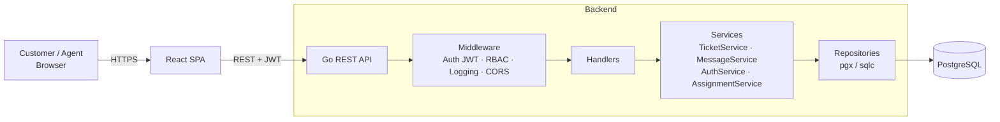
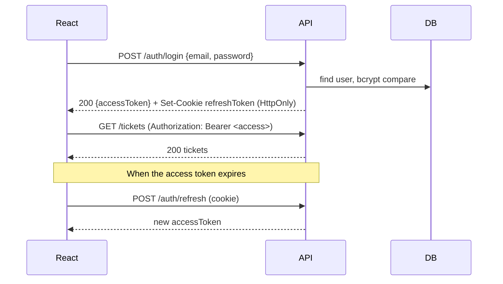
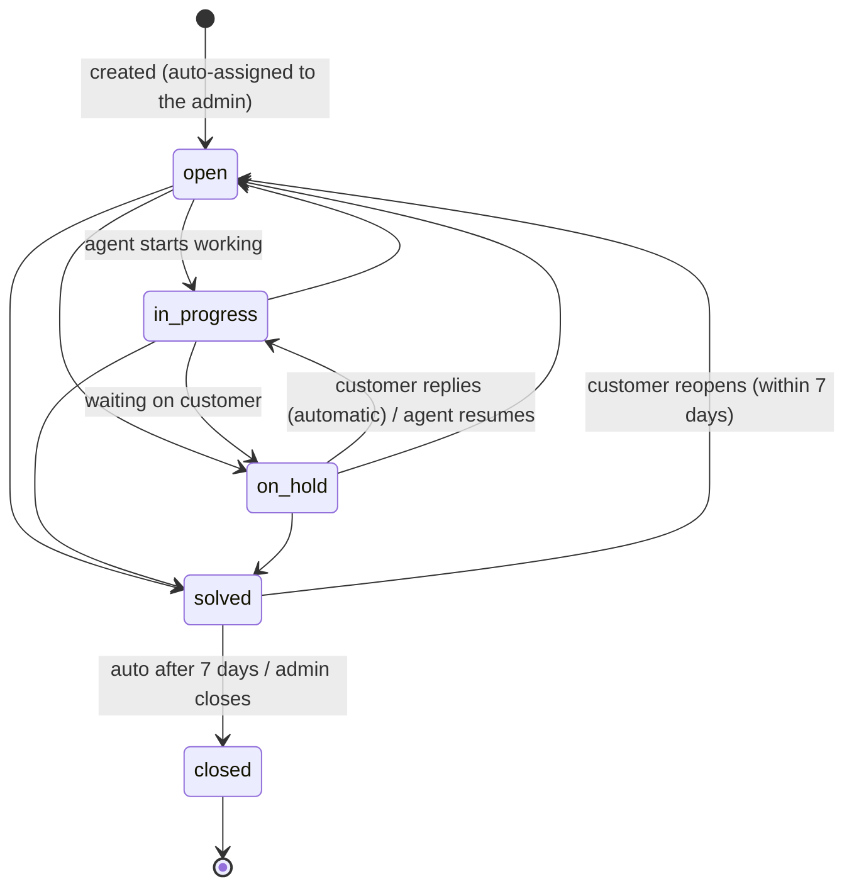
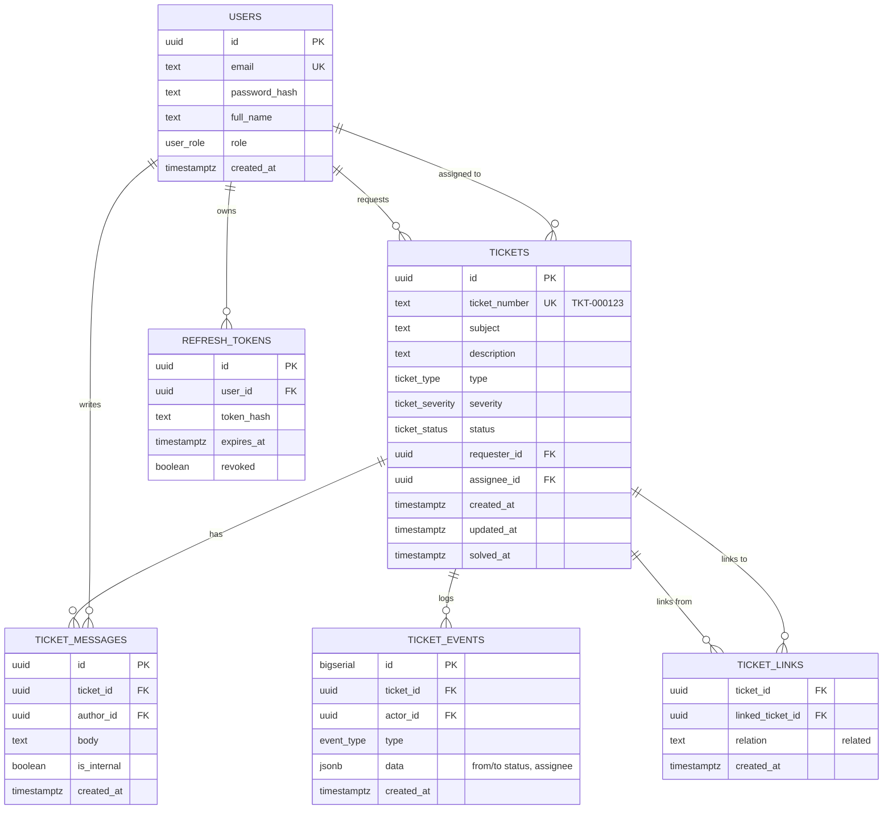
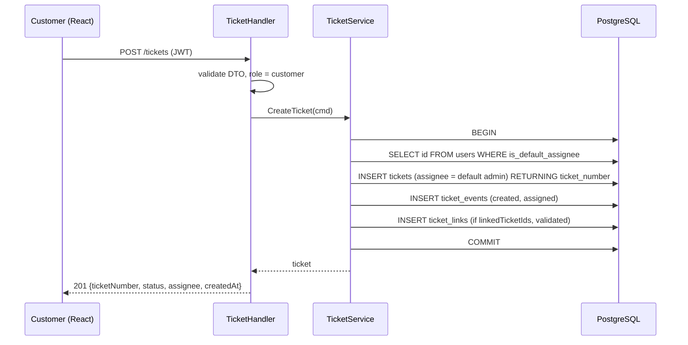
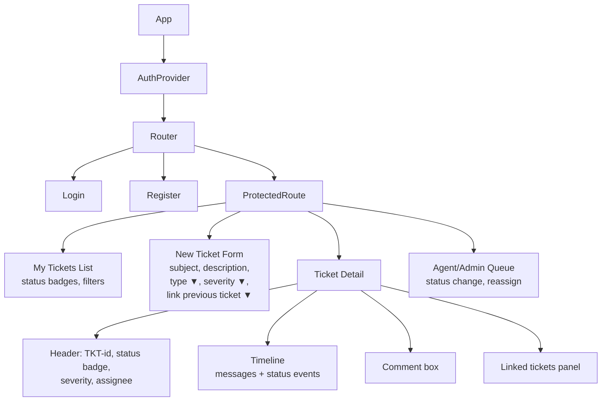

# Mini-Zendesk: Architecture

A small support ticketing system. A customer raises a ticket, it is auto-assigned to the default admin, it moves through a set of states, and the customer and agents talk to each other in a message thread on the ticket.

---

## 0. Getting Started (local)

Prerequisites: Go 1.23+, Node 20+, Docker.

```bash
# 1. Database (Postgres 16 on localhost:5435, settings come from .env)
docker compose up -d db

# 2. API (runs migrations from db/migrations and seeds the default admin) -> http://localhost:8080
cd api && go run ./cmd/server

# 3. Web app (proxies /api to the API) -> http://localhost:5180
cd web && npm install && npm run dev
```

**Sharing on your LAN:** the Vite dev server listens on all interfaces, so others on the same Wi‑Fi can open `http://<your-LAN-IP>:5180` (find it with `ipconfig getifaddr en0` on macOS). API calls go through the Vite proxy, so only port 5180 needs to be reachable. If the macOS firewall prompts, allow incoming connections for `node`.

Default admin: `ADMIN_EMAIL` / `ADMIN_PASSWORD` from `.env` (`admin@example.com` / `Admin@12345`). Customers register from the UI; the admin creates agents on the **Agents** page.

**Configuration:** every setting lives in the root `.env` (see `.env.example`). The DB connection is built from `DB_HOST`, `DB_PORT`, `DB_USER`, `DB_PASSWORD`, `DB_NAME`, `DB_SSL` in `api/internal/config/config.go`.

**Tests**

```bash
cd api && go test ./...   # services, state machine, auth, router, query builder
cd web && npm test        # Jest + React Testing Library
```

**Repository layout**

```
db/migrations/          SQL schema (golang-migrate format)          <- DB layer
api/                    Go REST API                                 <- backend
  cmd/server/           entry point (config -> DB -> services -> HTTP)
  internal/config       env loading + DB URL
  internal/database     pgx pool + migrations
  internal/repo         Repository interface, Postgres impl, in-memory fake (memrepo) for tests
  internal/service      business rules (auth, tickets, status machine, validation)
  internal/httpapi      chi router + handlers
  internal/auth         JWT, bcrypt, refresh tokens, auth/RBAC middleware
  internal/apperr, httpx  typed errors + JSON helpers (one error shape)
web/src/                React SPA                                   <- frontend
  api/                  axios client (JWT, auto-refresh on 401), endpoints, types
  auth/                 AuthContext, ProtectedRoute
  hooks/                TanStack Query hooks, live-refresh context
  components/, pages/   UI (Dashboard, Tickets list, Ticket detail, New ticket, Agents)
```

**Tables:** `users`, `tickets` (incl. `notify_emails TEXT[]`), `ticket_messages`, `ticket_events`, `ticket_links`, `ticket_attachments`, `ticket_chat_messages` (private 1:1 chat), `ticket_reads` (per-ticket notification read time; `users.notifications_read_at` stores "mark all read"), `refresh_tokens`, plus `schema_migrations` (managed by golang-migrate).

**New ticket form:** Subject, Description, Type and Notification emails (separated by `;`, pre-filled with your email) are required. Severity (defaults to medium), attachments and linked tickets are optional.

**Live chat (1:1):** the 💬 **Chat** button on a ticket opens a popup chat between the reporter and the current assignee. Chat is separate from comments. Admins who aren't the assignee can read it but not send. New messages arrive instantly over a Server-Sent Events stream, which reconnects automatically and reloads the history after a reconnect. A chat message from the other person also appears in the notification bell.

**HTTP/2:** set `TLS_CERT_FILE` and `TLS_KEY_FILE` in `.env` and the API serves HTTPS, which lets browsers use HTTP/2, so all chat streams and API calls share one connection. Without these the API runs plain HTTP/1.1, which is what the local setup uses.

**Dashboard & reports:** a time range picker (quick ranges from Last 1 hour to All time, a custom from/to, and « » to step back and forward) and an auto-refresh selector (Off, 5s … 1h, plus Refresh now). The dashboard shows Created, Resolved, Closed, Reopened and average resolution time, a created-vs-resolved trend chart, and breakdowns by status, severity and type. Admins and agents can **Export CSV** for the selected range. The ticket list has the same range filter, applied to created date.

**Notifications:** a bell in the top-right corner, available to every role, polls every 10 s. It lists activity by other people on tickets you raised or that are assigned to you: new tickets, assignments, status changes, comments, attachments and links. Internal notes are shown only to staff. Unread items are highlighted, the count appears on the bell and in the browser tab title, and tickets with unread activity get a dot in the ticket list. Opening a ticket marks its activity as read, and "Mark all as read" clears everything.

**Ticket page:** the ticket number, subject and actions (Comment and status changes) sit at the top. The main column shows Type, Status and Severity, then the read-only Description, Attachments (drag and drop or browse), and Activity with separate **Comments** and **History** tabs. The sidebar shows Assignee (with reassignment for staff), Reporter, notification emails, Created and Updated dates, and Linked tickets. All times show the timezone (e.g. `21 Nov 2026, 12:41 IST`). **Back** returns to the page you came from.

**Agents (admin):** the Agents page lists every active agent and admin with their count of open tickets, with search by name or email and a role filter. **Remove** deactivates an agent (soft delete, so names stay in ticket history). Their sessions are revoked, they can no longer sign in, and their unclosed tickets go back to the admin. Admins can't be removed.

**UI features:** filters (status, type, severity, search) and sorting are kept in the URL, with a table/card view toggle and pagination. **Live refresh** is on by default (every 10 s, plus a refetch when the window regains focus) and can be switched off; a **Refresh** button refreshes on demand. The dashboard is scoped by role: admins see all tickets, agents see their assigned tickets, customers see their own. Errors show inline with a Retry button, and an error boundary catches render crashes.

---

## 1. Tech Stack

| Layer      | Choice                                                                         | Why                                                                  |
| ---------- | ------------------------------------------------------------------------------ | -------------------------------------------------------------------- |
| Frontend   | React 18 + Vite + TypeScript, React Router, TanStack Query, Axios              | Small, fast, good handling of server state                           |
| Backend    | Go (chi router) REST API, `sqlc`/`pgx`                                         | Simple, typed, fast. Swappable with Node/Express if needed           |
| Database   | PostgreSQL 16                                                                  | Relational data (tickets, messages, links), enums, FKs, transactions |
| Auth       | JWT access token (15 min) + refresh token (HTTP-only cookie), bcrypt passwords | Stateless API, safe token storage                                    |
| Migrations | `golang-migrate`                                                               | Versioned schema                                                     |
| Deploy     | Docker Compose (web, api, db)                                                  | Brings the whole stack up with one command                           |

---

## 2. High-Level Architecture



**Layering:** `Handler (HTTP/DTO validation) → Service (business rules) → Repository (SQL)`.
Business rules such as auto-assignment, allowed status transitions, and link validation live only in the service layer.

---

## 3. Roles & Authentication

| Role       | Can do                                                                                                                  |
| ---------- | ----------------------------------------------------------------------------------------------------------------------- |
| `customer` | Register/login, create tickets, view **own** tickets, add messages, link own previous tickets, reopen own solved ticket |
| `agent`    | View assigned tickets, add messages (public or internal), change status, hand off own tickets to another agent/admin. Created by the admin only (no self-registration) |
| `admin`    | Everything an agent can do, plus view all tickets, reassign, manage agents. A **default admin** is seeded at startup    |



---

## 4. Ticket Lifecycle



**Statuses:** `open`, `in_progress`, `on_hold`, `solved`, `closed`.

- `in_progress` means an agent is actively working on the ticket.
- `on_hold` means the agent is waiting on the customer. When the customer replies, the ticket moves back to `in_progress` automatically.
- `solved` can be reopened. `closed` is final, so a recurring problem is handled with a **new ticket linked to the old one**.
- Agents can make any change except closing; only admins close tickets. Agents and admins change status from a dropdown on the ticket page.

Every status change is written to `ticket_events`, which feeds the timeline shown in the UI.

---

## 5. Database Schema (PostgreSQL)



```sql
CREATE TYPE user_role       AS ENUM ('customer','agent','admin');
CREATE TYPE ticket_status   AS ENUM ('open','in_progress','on_hold','solved','closed');  -- see migration 000006
CREATE TYPE ticket_type     AS ENUM ('technical','billing','account','feature_request','other');
CREATE TYPE ticket_severity AS ENUM ('low','medium','high','critical');
CREATE TYPE event_type      AS ENUM ('created','assigned','status_changed','message_added','linked');

CREATE TABLE users (
  id            UUID PRIMARY KEY DEFAULT gen_random_uuid(),
  email         CITEXT UNIQUE NOT NULL,
  password_hash TEXT NOT NULL,
  full_name     TEXT NOT NULL,
  role          user_role NOT NULL DEFAULT 'customer',
  is_default_assignee BOOLEAN NOT NULL DEFAULT false,
  created_at    TIMESTAMPTZ NOT NULL DEFAULT now()
);
CREATE UNIQUE INDEX one_default_assignee ON users(is_default_assignee) WHERE is_default_assignee;

CREATE SEQUENCE ticket_number_seq;
CREATE TABLE tickets (
  id            UUID PRIMARY KEY DEFAULT gen_random_uuid(),
  ticket_number TEXT UNIQUE NOT NULL
                DEFAULT 'TKT-' || lpad(nextval('ticket_number_seq')::text, 6, '0'),
  subject       VARCHAR(200) NOT NULL,
  description   TEXT NOT NULL,
  type          ticket_type NOT NULL,
  severity      ticket_severity NOT NULL DEFAULT 'medium',
  status        ticket_status NOT NULL DEFAULT 'open',
  requester_id  UUID NOT NULL REFERENCES users(id),
  assignee_id   UUID REFERENCES users(id),
  created_at    TIMESTAMPTZ NOT NULL DEFAULT now(),
  updated_at    TIMESTAMPTZ NOT NULL DEFAULT now(),
  solved_at     TIMESTAMPTZ
);
CREATE INDEX ON tickets(requester_id, created_at DESC);
CREATE INDEX ON tickets(assignee_id, status);

CREATE TABLE ticket_messages (
  id          UUID PRIMARY KEY DEFAULT gen_random_uuid(),
  ticket_id   UUID NOT NULL REFERENCES tickets(id) ON DELETE CASCADE,
  author_id   UUID NOT NULL REFERENCES users(id),
  body        TEXT NOT NULL,
  is_internal BOOLEAN NOT NULL DEFAULT false,
  created_at  TIMESTAMPTZ NOT NULL DEFAULT now()
);
CREATE INDEX ON ticket_messages(ticket_id, created_at);

CREATE TABLE ticket_events (
  id         BIGSERIAL PRIMARY KEY,
  ticket_id  UUID NOT NULL REFERENCES tickets(id) ON DELETE CASCADE,
  actor_id   UUID REFERENCES users(id),
  type       event_type NOT NULL,
  data       JSONB NOT NULL DEFAULT '{}',
  created_at TIMESTAMPTZ NOT NULL DEFAULT now()
);
CREATE INDEX ON ticket_events(ticket_id, created_at);

CREATE TABLE ticket_links (
  ticket_id        UUID NOT NULL REFERENCES tickets(id) ON DELETE CASCADE,
  linked_ticket_id UUID NOT NULL REFERENCES tickets(id) ON DELETE CASCADE,
  relation         TEXT NOT NULL DEFAULT 'related',
  created_at       TIMESTAMPTZ NOT NULL DEFAULT now(),
  PRIMARY KEY (ticket_id, linked_ticket_id),
  CHECK (ticket_id <> linked_ticket_id)
);

CREATE TABLE refresh_tokens (
  id         UUID PRIMARY KEY DEFAULT gen_random_uuid(),
  user_id    UUID NOT NULL REFERENCES users(id) ON DELETE CASCADE,
  token_hash TEXT NOT NULL,
  expires_at TIMESTAMPTZ NOT NULL,
  revoked    BOOLEAN NOT NULL DEFAULT false
);
```

**Key design decisions**

- `id` (UUID) is used internally. `ticket_number` (`TKT-000123`) is the readable id shown to the customer.
- The UI timeline is built by merging `ticket_messages` with `ticket_events`, sorted by `created_at`.
- When a ticket is linked to a previous ticket, the service checks that both tickets belong to the same requester and that the old ticket is `solved` or `closed`.
- Ticket type and severity are Postgres enums. The React dropdowns get their values from `GET /meta/enums`.

---

## 6. REST API (`/api/v1`)

| Method | Endpoint                                 | Role                                | Description                                                                  |
| ------ | ---------------------------------------- | ----------------------------------- | ---------------------------------------------------------------------------- |
| POST   | `/auth/register`                         | public                              | Register a customer                                                          |
| POST   | `/auth/login`                            | public                              | Returns an access token and sets the refresh cookie                          |
| POST   | `/auth/refresh`                          | cookie                              | Issues a new access token                                                    |
| POST   | `/auth/logout`                           | auth                                | Revokes the refresh token                                                    |
| GET    | `/me`                                    | auth                                | Current user                                                                 |
| GET    | `/meta/enums`                            | auth                                | Ticket types, severities, statuses                                           |
| POST   | `/tickets`                               | customer                            | Create a ticket (auto-assigned to the default admin)                         |
| GET    | `/tickets?status=&type=&severity=&search=&createdFrom=&createdTo=&page=` | auth | Multi-select filters as comma lists (e.g. `status=open,pending`); search matches ticket number, subject or type. Customers see their own tickets, agents see assigned tickets, admins see all |
| GET    | `/tickets/{id}`                          | owner/agent                         | Ticket details plus linked tickets                                           |
| GET    | `/tickets/{id}/timeline`                 | owner/agent                         | Messages and events in order (internal notes are hidden from customers)      |
| POST   | `/tickets/{id}/messages`                 | owner/agent                         | Add a comment                                                                |
| PATCH  | `/tickets/{id}/status`                   | agent/admin (customer: reopen only) | `{ "status": "solved" }`, checked against the state machine                  |
| PATCH  | `/tickets/{id}/assignee`                 | admin / assigned agent              | `{ "assigneeId": "..." }` to reassign (single assignee per ticket)           |
| POST   | `/tickets/{id}/links`                    | owner                               | `{ "linkedTicketId": "..." }`                                                |
| DELETE | `/tickets/{id}/links/{linkedId}`         | owner                               | Remove a link                                                                |
| GET    | `/agents`                                | admin / agent                       | List of agents for the reassign dropdown                                     |
| POST   | `/agents`                                | admin                               | Create an agent account                                                      |
| DELETE | `/agents/{id}`                           | admin                               | Remove (deactivate) an agent; their unclosed tickets are reassigned to the admin |
| GET    | `/healthcheck` (also `/healthz`, `/api/v1/healthcheck`) | public               | `{status, db, dbLatencyMs, uptimeSeconds}`; returns 503 if the database is down |
| POST   | `/tickets/{id}/attachments`              | owner/agent                         | Upload one file (`multipart/form-data`, field `file`, max 5 MB, 10 per ticket) |
| GET    | `/tickets/{id}/attachments/{attId}`      | owner/agent                         | Download a file (always served as an attachment)                             |
| GET    | `/reports/summary`                       | auth                                | Dashboard counts by status/severity/type + recent tickets (role-scoped)      |
| GET    | `/reports/summary?from=&to=&tz=`         | auth                                | Created/resolved/closed/reopened, average resolution time, trend and breakdowns for a date range (role-scoped) |
| GET    | `/reports/export?from=&to=&tz=`          | admin / agent                       | CSV of tickets created in the range (agents: assigned tickets only)          |
| GET    | `/tickets/{id}/chat`                     | reporter / assignee / admin (read)  | 1:1 chat history and whether you can send                                    |
| POST   | `/tickets/{id}/chat`                     | reporter / assignee                 | `{ "body": "..." }` send a chat message                                      |
| GET    | `/tickets/{id}/chat/stream`              | reporter / assignee / admin (read)  | Live chat via Server-Sent Events (HTTP/2 when served over TLS)               |
| GET    | `/notifications`                         | auth                                | Recent activity by others on tickets you requested or are assigned to, with unread count |
| POST   | `/notifications/read`                    | auth                                | `{ "ticketId": "..." }` marks one ticket read; `{}` marks everything read     |

**Create ticket example**

```http
POST /api/v1/tickets
Authorization: Bearer <token>

{ "subject": "Cannot login", "description": "Getting 500 on login",
  "type": "technical", "severity": "high", "linkedTicketIds": ["<old-ticket-uuid>"] }
```

```json
201 Created
{ "id": "6f1c...", "ticketNumber": "TKT-000124", "status": "open",
  "assignee": { "id": "...", "name": "Default Admin" },
  "createdAt": "2026-11-21T05:40:00Z" }
```

Errors use one shape: `{ "error": { "code": "INVALID_TRANSITION", "message": "..." } }`, returned with status 400, 401, 403, 404, 409, or 422.

### Create Ticket Flow



---

## 7. Frontend (React)



```
web/src/
  api/          axios client (JWT interceptor, refresh on 401), tickets.ts, auth.ts
  auth/         AuthContext, ProtectedRoute
  pages/        Login, Register, TicketList, NewTicket, TicketDetail, AgentQueue
  components/   StatusBadge, SeverityBadge, Timeline, MessageComposer, LinkTicketPicker
  hooks/        useTickets, useTicket, useTimeline (TanStack Query)
```

- After a ticket is created, the user goes to `/tickets/TKT-000124` and sees a confirmation with the ticket id.
- The link picker shows the user's own `solved`/`closed` tickets, with search.
- The timeline polls every 15 seconds through TanStack Query `refetchInterval`, so status changes show up without a page refresh.

---

## 8. Backend Project Layout

```
mini-zendesk/
  api/
    cmd/server/main.go
    internal/
      auth/        jwt.go, middleware.go, rbac.go
      http/        router.go, handlers/ (auth, tickets, messages, links)
      service/     ticket_service.go, status_machine.go, assignment.go
      repo/        sqlc-generated queries
      config/
    migrations/    0001_init.up.sql ...
  web/             React app
  docker-compose.yml   (postgres, api, web)
```

---

## 9. Security & Non-Functional Requirements

- Passwords are hashed with bcrypt (cost 12). Refresh tokens are stored hashed and rotated on every use.
- The API checks ownership on every ticket endpoint. Customers get `404` for tickets that are not theirs.
- All SQL is parameterised. Input lengths are validated. Endpoints are served over HTTPS only, CORS is limited to the web origin, and `/auth/*` is rate-limited.
- All multi-table writes (create, status change, link) run inside a single transaction.
- Possible later additions: email notifications, SLA by severity, round-robin assignment, attachments (S3), manager dashboard (`GET /reports/summary`).
